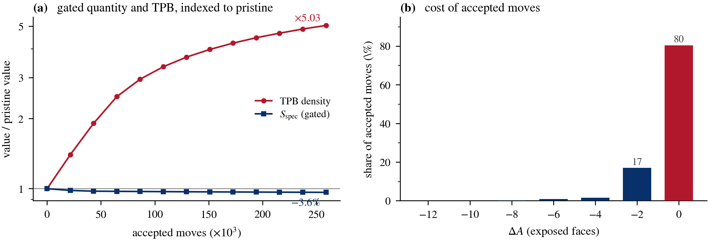

# Validation criteria that exclude their own mechanism

[](https://github.com/mehtaarnav/voxel-damage-operators-niysz/actions/workflows/ci.yml)
[](LICENSE)
[](https://doi.org/10.5281/zenodo.21969405)
[](requirements.txt)

Code, pre-registration documents, result tables and manuscript for a study of
voxel-scale damage operators applied to segmented FIB-SEM tomograms of Ni–YSZ
solid oxide cell anodes. The manuscript is
[`out/writeup/manuscript.tex`](out/writeup/manuscript.tex).

## Summary

Voxel damage operators are judged by validity criteria their authors choose,
such as monotone loss of specific surface area for a coarsening rule. On three
real anodes we find that operators can satisfy such criteria in full while
moving the microstructure away from the physics they represent.



A volume-conserving swap operator lowers specific surface area by 3.6 % at
exact volume conservation, as the criterion requires, while triple-phase-boundary
(TPB) density rises by a factor of 4.99. About 80 % of accepted moves change
the area by exactly zero, so the criterion does not constrain them. Replaying
the moves in groups shows the inflation is local: moves that touch the
nickel–zirconia contact reproduce all of it (×5.03), and all other moves
together give ×1.04. Strict inequality reduces the effect but does not remove
it. A practical consequence is a one-line check: in a fixed volume, an operator
whose TPB retention exceeds one is roughening the structure, not coarsening it.

## Failure modes

Four are implementation faults that a different choice of convention removes.

| # | Failure mode | Evidence |
|---|---|---|
| 1 | Planar lattice cuts | A jittered lattice fails at one full cross-section with zero seed-to-seed variance; real networks fail at 0.5–3 % of throats. |
| 2 | Over-connected gates | Requiring perfect pristine connectivity misrepresents electrodes that carry 1.2–11.2 % disconnected nickel before service. |
| 3 | Pruning circularity | Keeping only the largest connected component fixes the spanning fraction at exactly 1, so the operator rewrites the metric used to judge it. |
| 5 | Curvature rank is not area change | Ranking moves by a curvature proxy raises specific surface area at the first step. |

Two are properties of the move class and are not removed by any implementation.

| # | Failure mode | Evidence |
|---|---|---|
| 4 | Voxel moves create TPB | TPB rises 7–15× under erosion and 3.7–5.0× under a swap that conserves volume and lowers area. |
| 6 | Area monotonicity excludes break-up | Rayleigh-type neck break-up needs a transient area increase, which the criterion forbids; no operator that respected it thinned a neck. |

Numbering follows the manuscript. A longer explanation of the physics and the
operators is in the [primer](out/writeup/primer.html).

## The measured target

The anodes are the fine, medium and coarse Ni–YSZ series of Pecho, Holzer and
co-workers, imaged before and after eight redox cycles. Pristine and degraded
stacks are different specimens. The fine anode retains nickel percolation worst
and TPB best. Its porosity rises from 25 to 47 vol % through irreversible
swelling, and the share of nickel–zirconia contact adjacent to pore rises from
0.034 to 0.089; the medium and coarse anodes show neither. None of the
operators studied can swell, and the manuscript states this as a limitation.
The failure modes above do not depend on which mechanism produced the target.

## Repository layout

| Path | Contents |
|---|---|
| `cmlib/` | Library: percolation, TPB estimator, network extraction, metrics, damage operators, synthetic generators, I/O |
| `phase0_*.py` … `phase6_*.py` | First project: data download, label checks, volume fractions, TPB, network metrics, percolation |
| `scripts/project2/` | Second project: operator runs, audits, figures, number verification, tests |
| `scripts/relook/` | Sub-block scan of all six stacks |
| `probe_*.py`, `diag_*.py` | Library and memory probes kept for the record |
| `out/` | Result tables, pre-registrations, run reports, manuscript and figures |

`cmlib/damage.py` and `cmlib/synth.py` were frozen by pre-registration and are
not edited.

## Reproducing results

```bash
pip install -r requirements.txt
python check_env.py
pytest scripts/project2/test_operators.py
python scripts/project2/verify_manuscript_numbers.py
```

The last command recomputes every number quoted in the manuscript from the
committed tables and checks it against the text. Continuous integration runs
it on every push, together with a pixel comparison of every figure that
depends only on committed tables.

Anything that reads the tomograms needs the segmented stacks first, about
140 MB to download and 2.1 GB unpacked:

```bash
python phase1_download.py
```

The mapping from manuscript numbers to source tables is in the paper's data
availability section and in
[`out/writeup/REPRODUCIBILITY_MANIFEST.md`](out/writeup/REPRODUCIBILITY_MANIFEST.md).
Known issues that were found in review and deliberately not fixed are listed in
[`KNOWN_ISSUES.md`](KNOWN_ISSUES.md).

## Data

The tomography data is not included or redistributed here. It is the
Holzer/Pecho Ni–YSZ FIB-tomography dataset,
[Zenodo 4056538](https://zenodo.org/records/4056538), published under its own
terms. `phase1_download.py` fetches it into `data/`, which is gitignored.

## Citation and licence

Code is released under the MIT licence. To cite the software, use
[`CITATION.cff`](CITATION.cff) or the concept DOI
[10.5281/zenodo.21969405](https://doi.org/10.5281/zenodo.21969405), which
resolves to the latest release. To cite the findings, cite the paper.
